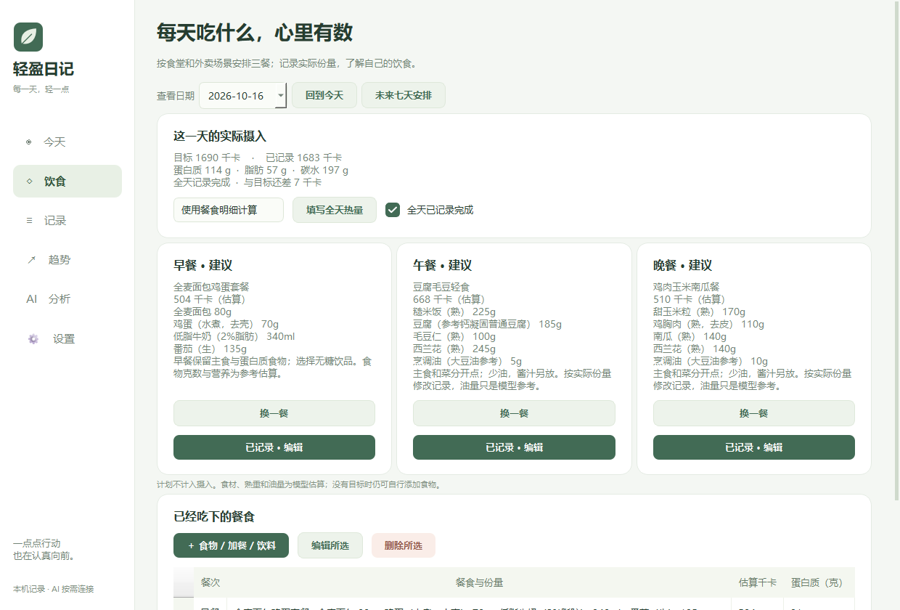
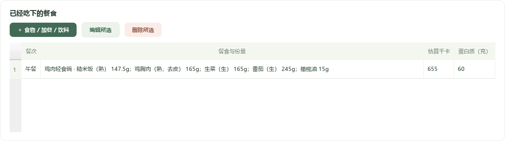
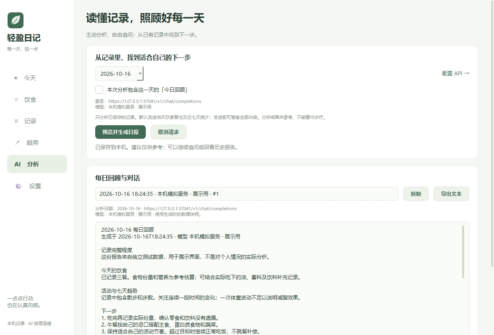

# LightDiary · Offline food diary for Windows

[简体中文](README.md) · English

Record what you ate from a canteen or takeout meal, down to the portion of each ingredient. LightDiary keeps a local food, exercise and weight journal with 7-day and 30-day trends. The interface is in Simplified Chinese; the walkthrough below translates the buttons you’ll need.

**[Download the Windows x64 EXE](https://github.com/troulierkilian-blip/LightDiary/releases/latest/download/LightDiary.exe)** · [Release notes and SHA-256 checksums](https://github.com/troulierkilian-blip/LightDiary/releases/latest) · [Chinese user guide](使用说明.md)

Run `LightDiary.exe` on Windows 10 (1809 or later) or Windows 11 x64. The release was tested on Windows 11. No account or Python installation is required. Before upgrading, right-click the old version’s tray icon and choose **彻底退出** (Quit).



## Log a lunch and adjust one ingredient

1. Open **饮食** (Meals). Set a nutrition profile or a manual calorie target to generate suggestions from 36 meal combinations. To skip setup, choose **＋ 食物 / 加餐 / 饮料** (Add food, snack or drink) and select from 71 built-in foods or add your own.
2. After lunch, choose **按这餐记录** (Log this meal). In the example chicken bowl, the plan includes 295 g of cooked brown rice. If you ate half the rice, select **已记录 · 编辑** (Recorded · Edit), enter 147.5 g for the rice, and select **保存实际摄入** (Save actual intake). This updates the same lunch entry and keeps the portions for the chicken and vegetables.
3. Open **今天** (Today) to see the totals so far. Once every meal, snack and drink is accounted for, tick **全天已记录完成** (Full day logged). The averages in **趋势** (Trends) use days marked complete.



The example uses synthetic records. Ingredient amounts and nutrition values are estimates.

## Optional AI review

Daily logging works offline. To request a report, configure a Chat Completions-compatible endpoint, model and your own API key under **设置 → AI 接入**. In **AI 分析**, preview the outgoing messages before sending. They include records for the selected day, statistics for the previous six days and relevant settings. The written daily reflection is excluded by default. The provider may charge for requests.



Reports and follow-up conversations are saved by date. Nutrition estimates and AI responses are for personal tracking; consult a qualified professional for medical advice.

## Storage and backups

Records, settings and AI reports stay in `%LOCALAPPDATA%\LightDiary`. Export daily summaries or meal details as CSV, or create a full backup under Settings. Diary files and backups are unencrypted. Windows DPAPI encrypts the API key separately for the current user; enter it again after restoring a backup.

## Build from source

On Windows x64 with Python 3.10, run this from the project root in PowerShell.

```powershell
powershell -ExecutionPolicy Bypass -File .\build.ps1
```

The script creates the environment, installs pinned dependencies, runs tests and packages `dist\轻盈日记.exe`. To check the downloaded release file, compare `Get-FileHash .\LightDiary.exe -Algorithm SHA256` with the release checksum list.

## Terms and support

The project is publicly available to view and download. The author has not granted an open-source license for the original code. Third-party components and food data retain their respective terms. See the [third-party notices](THIRD_PARTY_NOTICES.txt), [license texts](licenses/) and [project support options](README.md#支持项目).
