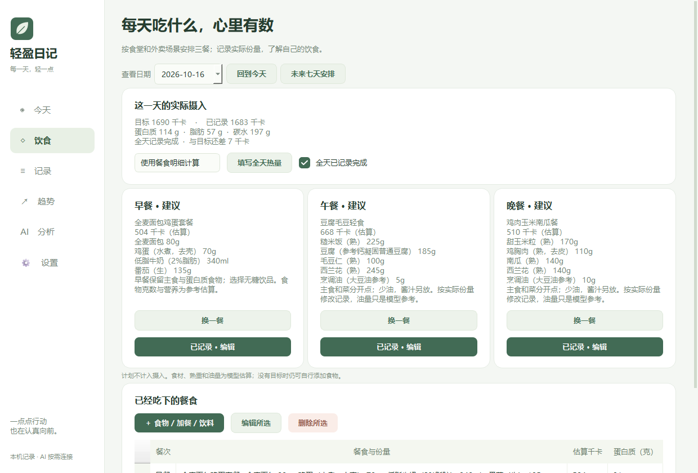
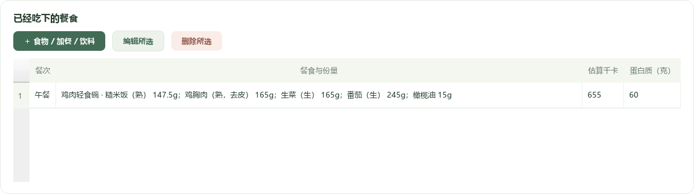
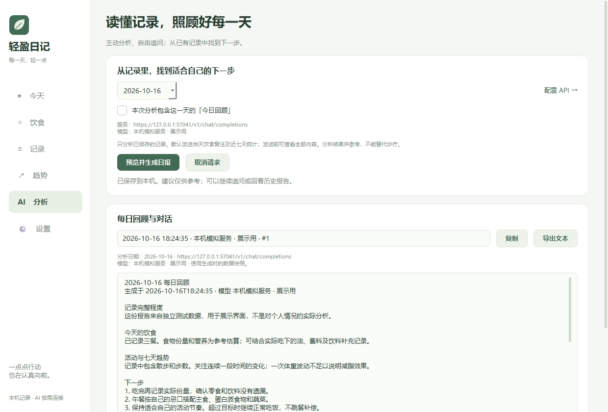

# 轻盈日记 · LightDiary

简体中文 · [English](README.en.md)

把食堂或外卖的一餐记成你实际吃下的份量。轻盈日记是一款 Windows 离线饮食日记，也可以记录运动、体重，并查看近 7 天或 30 天的趋势。

**[下载 Windows x64 免安装版](https://github.com/troulierkilian-blip/LightDiary/releases/latest/download/LightDiary.exe)** · [发布说明与 SHA-256](https://github.com/troulierkilian-blip/LightDiary/releases/latest) · [中文使用说明](使用说明.md)

双击下载的 `LightDiary.exe` 即可使用，无需账号或 Python。支持 Windows 10 1809 及以上和 Windows 11 x64；发布验证使用 Windows 11。升级前，请右键旧版托盘图标，选择「彻底退出」。



## 试记一顿食堂午餐

1. 打开 **饮食**。填写饮食资料或设置手动热量目标后，可从 36 套食堂、外卖等组合生成三餐计划。也可以跳过目标，直接用 **＋ 食物 / 加餐 / 饮料** 从 71 种内置食物中选取或添加自己的食物。
2. 吃完后，在午餐卡片点 **按这餐记录**。例如示例中的鸡肉轻食碗原有 295 克熟糙米饭，你吃了半份，就点 **已记录 · 编辑**，把这项改为 147.5 克，再点 **保存实际摄入**。同一条午餐记录会更新，鸡肉和蔬菜的份量保持原值。
3. 在 **今天** 查看已记录的摄入汇总。三餐、零食和饮料都记完后，勾选 **全天已记录完成**；**趋势** 页的平均热量按记录完整的日期计算。



上图使用独立示例数据。食材、份量和营养值均为估算。

## 可选的 AI 日报

在「设置 → AI 接入」填写兼容 Chat Completions 的服务地址、模型名称和自己的 API Key。保存当日记录后，到「AI 分析」预览并发送；可按日期回看报告和继续追问。不配置 API 不影响离线功能。



上图来自独立测试数据和本机模拟服务。主动分析时，服务商会收到预览中所示的当天记录、前六天的统计及相关设置，可能计费。「今日回顾」默认不发送。热量和份量是估算，AI 回答不能替代专业诊疗。

## 数据与备份

记录、设置和 AI 报告保存在 `%LOCALAPPDATA%\LightDiary`。更换 EXE 不会清空记录。可从设置导出 CSV 或完整备份；日记和备份本身未加密。API Key 单独使用 Windows DPAPI 按当前用户加密，不进入备份，恢复备份后需要重新填写。

## 从源码构建

在 Windows x64 上准备 Python 3.10 和 PowerShell，从项目根目录运行：

```powershell
powershell -ExecutionPolicy Bypass -File .\build.ps1
```

脚本建立虚拟环境、安装固定版本的依赖、运行测试，先验证目录版，再生成 `dist\轻盈日记.exe`。发布页附有验证报告和各附件的 SHA-256；可用 `Get-FileHash .\LightDiary.exe -Algorithm SHA256` 核对下载。

## 使用与许可

本项目公开供查看和下载。自有代码未采用 MIT 或其他开源许可证；公开仓库本身不额外授予修改、再分发或商用自有代码的许可。第三方组件和公开食物数据仍适用其各自的条款，详见[第三方声明](THIRD_PARTY_NOTICES.txt)和[许可文本](licenses/)。

## 支持项目

如果「轻盈日记」帮到了你，欢迎通过支付宝或微信扫码打赏。感谢你的支持！

| 支付宝 | 微信 |
| :---: | :---: |
|  |  |
